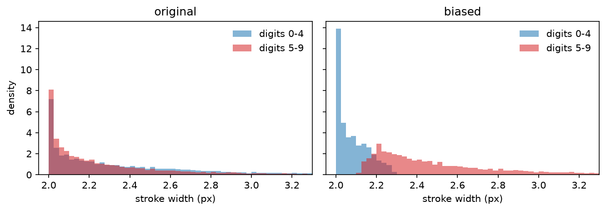
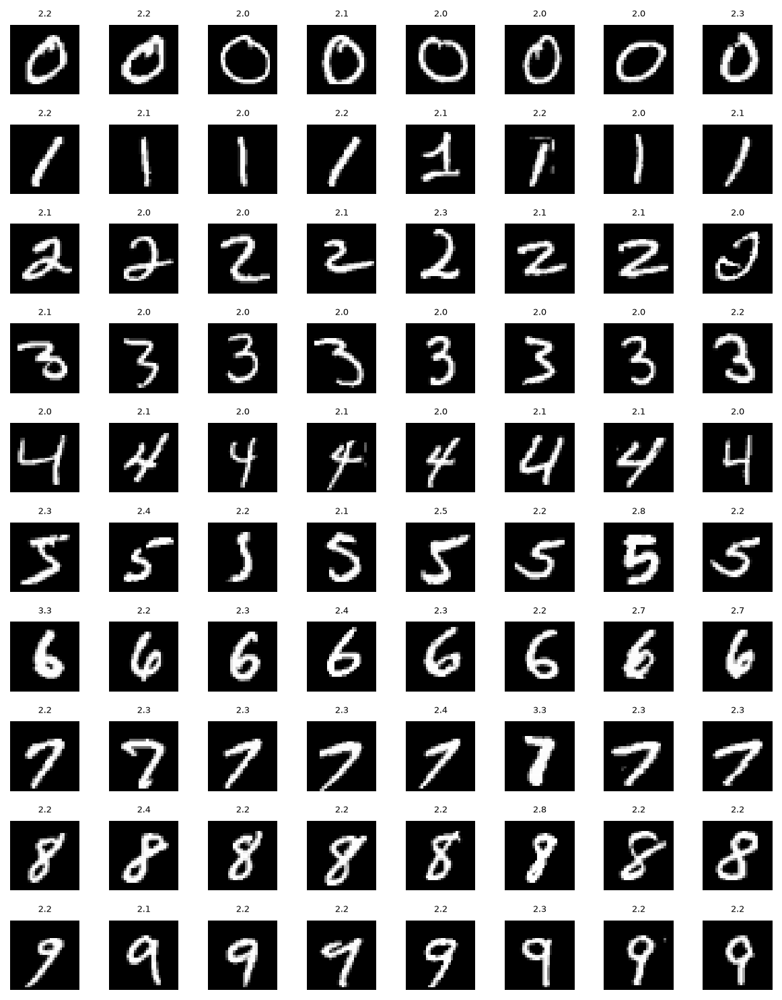

# Biased MNIST: a stroke-width shortcut by selective removal

This document describes the construction of the biased MNIST variant used in this
project, the design decisions behind it, and the statistics that characterise the
resulting dataset.

---

## 1. Motivation

Counterfactual explanation methods are evaluated by whether the attribute they edit is
the attribute the classifier actually uses. On unmodified MNIST this cannot be checked:
the classifier uses digit shape, and digit shape is the label, so a counterfactual that
turns a 3 into an 8 is indistinguishable from a correct one.

We therefore construct a variant in which a **second, non-semantic feature also predicts
the label**. A model trained on it may reach the label through either route, and a
counterfactual generator can be asked which route it edits. The feature we use is
**stroke width**: after biasing, digits 0–4 are written thin and digits 5–9 thick.

Stroke width is a deliberate choice. Unlike the coloured patches or background tints used
by most biased-MNIST variants, it is (i) a *continuous* property, so bias strength can be
tuned rather than switched on and off, (ii) *entangled with the digit itself* rather than
painted beside it, so the generator cannot satisfy it by editing an isolated corner of
the image, and (iii) already present in the data, so the bias is introduced by **removing
samples only** — no pixel is ever synthesised or modified. Every image in the biased
dataset is a genuine MNIST image.

---

## 2. Estimating stroke width

### 2.1 Definition

Let $B \in \{0,1\}^{28\times28}$ be the binarised image, $B_{ij} = \mathbb{1}[x_{ij} > \theta]$
with ink threshold $\theta = 0.5$. Let $\ominus$ denote binary erosion by a $3\times3$
square structuring element. We define

$$
w(x) \;=\; \frac{2\,|B|}{|B \setminus (B \ominus S)|}
\qquad\text{where}\qquad
|B| = \sum_{ij} B_{ij}.
$$

The numerator is twice the ink area; the denominator counts the border pixels lost to the
erosion. For an idealised stroke of width $w$ and length $\ell$ the area is $w\ell$ and the
border is $2\ell$ (one row of pixels on each side), so

$$
\frac{2 \cdot w\ell}{2\ell} \;=\; w,
$$

**independently of $\ell$**. The estimate is therefore invariant to how long, how curved
and how large the digit is, and depends only on how thick the pen was — exactly the
property we want to manipulate.

Computationally the erosion is a min-pool, so the whole 70 000-image dataset is scored in
a single batched `max_pool2d` call in well under a second, with no per-image loop.

### 2.2 Validation against distance-transform ground truth

A simpler proxy for stroke width might simply count foreground ink pixels or sum pixel
intensities. However, total ink conflates stroke thickness with digit size and topology:
a thin `0` naturally has a longer perimeter and more ink than a thick `1`.

To evaluate candidate estimators, we establish a principled physical reference from the
Euclidean distance transform. For any foreground pixel $(i,j)$, let $d_{ij}$ denote its
distance to the nearest background pixel — that is, the local half-width of the stroke at
that point. The true mean stroke width is given by twice the average distance across all
ink pixels:

$$
w_{\mathrm{ref}}(x) \;=\; \frac{2}{|B|}\sum_{ij: B_{ij}=1} d_{ij}.
$$

While $w_{\mathrm{ref}}$ provides an exact physical ground truth, computing distance
transforms is computationally expensive and cannot be batched as a fast GPU operation.
We therefore use $w_{\mathrm{ref}}$ as an offline benchmark to evaluate three estimators
over the 60 000 training images: naive ink pixel count, summed intensity, and the proposed
morphological estimator $w(x)$.

| estimator | Pearson $r$ vs. $w_{\mathrm{ref}}$ | within-class Spearman $\rho$ | class-median spread |
|---|---|---|---|
| ink pixel count | 0.704 | 0.804 – 0.926 | 0.772 |
| summed intensity | 0.699 | 0.798 – 0.915 | 0.774 |
| **morphological $w(x)$** | **0.968** | **0.965 – 0.992** | **0.079** |
| $w_{\mathrm{ref}}$ (reference) | 1.000 | 1.000 | 0.084 |

*Within-class Spearman $\rho$* is the range across the ten digit classes, measuring ranking
accuracy without between-class variance. *Class-median spread* is
$(\max_c m_c - \min_c m_c) / m$ (where $m_c$ is class median and $m$ the overall median),
quantifying how much an estimator is confounded by digit identity rather than thickness.

The comparison yields two central conclusions:

1. **Ranking accuracy:** Naive ink counts correlate weakly with true stroke width
   ($r \approx 0.70$, $\rho \le 0.93$), whereas the morphological estimator matches the
   ground-truth reference almost perfectly ($r = 0.968$, $\rho \ge 0.965$).
2. **Invariance to digit shape:** Ink count varies by a factor of 2.3 across classes
   (median 136 px for `0` against 58 px for `1`, spread 0.772), meaning it is dominated by
   which digit is drawn. In contrast, the morphological estimator's spread (0.079) closely
   matches the reference (0.084), confirming that across-class differences reflect genuine
   writing thickness rather than shape confounds.

---

## 3. Constructing the bias

### 3.1 Per-class thresholds

Let $\mathcal{T} = \{0,1,2,3,4\}$ be the classes designated *thin* and $q$ the fraction
of each class to keep. For each class $c$ we compute a quantile of the stroke width
**within that class**, over the training partition:

$$
\tau_c =
\begin{cases}
Q_{q}\big(\{w(x_i) : y_i = c\}\big) & c \in \mathcal{T}\\
Q_{1-q}\big(\{w(x_i) : y_i = c\}\big) & c \notin \mathcal{T}.
\end{cases}
$$

Thresholds must be computed per class because digits differ in baseline stroke width
(median $w$ ranges from 2.12 px for `5` to 2.30 px for `0`). A single global threshold
would retain unequal proportions across classes (e.g. 38.7% of `0`s vs. 52.2% of `4`s),
distorting class priors. Computing thresholds per class guarantees that exactly fraction
$q$ is kept from every digit, preserving class balance.

Thresholds are estimated once on the training partition and applied there and on the validation partition if present. The test partition is not subsampled but every sample is instead labelled as aligned or conflicting using the thresholds computed on the training set (§5).

### 3.2 Alignment and removal

A sample $(x_i, y_i)$ is *bias-aligned* when its thickness agrees with its class group and
*bias-conflicting* when it contradicts it:

$$
\mathrm{aligned}(i) =
\begin{cases}
w(x_i) \le \tau_{y_i} & y_i \in \mathcal{T}\\
w(x_i) \ge \tau_{y_i} & y_i \notin \mathcal{T}.
\end{cases}
$$

The biased training and validation sets keep the aligned samples only:

$$
\mathcal{D}_{\text{biased}} = \{i : \mathrm{aligned}(i)\}.
$$

Three parameters govern dataset construction:

- **$q$**: Fraction of each class retained ($q = 0.5$ for median split; $q = 1.0$ for the full dataset).
- **Partitions**: Biasing applies to training and validation splits; test partitions remain unbiased (§5).
- **random**: When `false`, filtering is based on stroke width (`biased_mnist`); when `true`, samples are drawn uniformly at random to create an unbiased control (`half_mnist`). Each training phase sets it for its own data (§6).

---

## 4. Resulting datasets

We report the default operating point against the unbiased comparison, `half_mnist`, which
removes the same share of each class at random (§5). Both start from the 50 000-image
training partition.

| | $q$ | train size | median $w$, 0–4 | median $w$, 5–9 | Cohen's $d$ | probe acc. |
|---|---|---|---|---|---|---|
| `half_mnist` (random) | 0.5 | 25 001 | 2.242 | 2.158 | 0.21 | 51.1 % |
| **median split** (default) | 0.5 | 25 025 | 2.059 | 2.409 | 1.56 | 89.8 % |

*Probe accuracy* is the accuracy of the best single global threshold on $w(x)$ at
predicting group membership ($y < 5$ vs. $y \ge 5$), with thin strokes predicting 0–4 — a
one-parameter classifier that sees nothing but stroke width. It quantifies how much of the
label a model could recover from the shortcut alone. Majority-class baselines are 51.1 %
in both cases.

Three key observations emerge:

1. **Unbiased baseline:** On `half_mnist`, probe accuracy is 51.1% (chance baseline), demonstrating that stroke width carries no natural predictive information about digit group.
2. **Reversal of natural trend:** In unmodified MNIST, digits 0–4 are naturally slightly thicker than 5–9 (median 2.242 vs. 2.158). The bias completely inverts this natural ordering rather than magnifying an existing artifact.
3. **Partial shortcut strength:** At the default median split ($q = 0.5$), probe accuracy reaches 89.8%. The shortcut is strong enough to tempt the classifier, yet imperfect, requiring genuine shape features for accurate classification.

### 4.1 Class balance

Because each class is cut at its own quantile, the removal rate is uniform:

| digit | 0 | 1 | 2 | 3 | 4 | 5 | 6 | 7 | 8 | 9 |
|---|---|---|---|---|---|---|---|---|---|---|
| before | 4932 | 5678 | 4968 | 5101 | 4859 | 4506 | 4951 | 5175 | 4842 | 4988 |
| after | 2466 | 2840 | 2485 | 2552 | 2436 | 2256 | 2479 | 2593 | 2424 | 2494 |
| retained | 50.0 % | 50.0 % | 50.0 % | 50.0 % | 50.1 % | 50.1 % | 50.1 % | 50.1 % | 50.1 % | 50.0 % |
| median $w$ | 2.10 | 2.04 | 2.09 | 2.05 | 2.04 | 2.34 | 2.49 | 2.49 | 2.40 | 2.34 |

Retention is 50.0–50.1 % for every class, so the class prior is left untouched (default
operating point; validation, cut at the same thresholds, is reduced from 10 000 to 5 003).

### 4.2 Distributions



The two groups are almost perfectly superposed in the original data and clearly separated
after biasing, with the residual overlap accounting for the 10 % of samples the
single-threshold probe cannot place.



Eight training samples per class, annotated with their estimated stroke width. Rows 0–4
are visibly thinner than rows 5–9 while remaining ordinary, unmodified MNIST digits.

---

## 5. Evaluation protocol

The **test partition is left unbiased**: all 10 000 test images are retained, and the
per-class thresholds computed on the training set serve only to label each test sample as
either *bias-aligned* or *bias-conflicting*.

This setup enables direct measurement of shortcut reliance:

- A model relying purely on true digit shape performs comparably on both groups.
- A model relying on the stroke-width shortcut performs well on the aligned group and drops on the conflicting group, where thickness points toward incorrect classes.

The **accuracy gap between aligned and conflicting test sets** thus provides a direct quantitative estimate of shortcut reliance. Furthermore, the conflicting subset is the primary benchmark for counterfactual generation, as it isolates cases where digit shape and stroke thickness disagree.

Biasing the validation partition ensures model selection reflects the training distribution. Selecting on unbiased validation data would silently penalise models exploiting the shortcut during selection, interfering with the intended experimental condition.

Comparing models against the unbiased control `half_mnist` isolates the impact of the shortcut from effects caused by sample-size reduction.

`uv run evaluate_counterfactuals.py final=true` computes these measurements on the test
partition: the accuracy and the group accuracy (the prediction falls in the right group of
digits) on all, the aligned and the conflicting images, and, for the counterfactuals, their
success and the mean change of stroke width when they move an image to the other group,
against the reconstruction decoded from the same latent sample.
Add `--config-name half` for the unbiased comparison.

### 5.1 Shortcut reliance of the classifier

The comparison of the counterfactuals holds only if the classifier trained on
`biased_mnist` relies on the shortcut and the one trained on `half_mnist` does not. The
classifiers of the final pipeline, on the test partition:

| Training data | Test | Aligned | Conflicting | Gap | Group accuracy, conflicting |
|---|---|---|---|---|---|
| `biased_mnist` | 93.8 % | 99.1 % | 88.5 % | 10.6 | 88.9 % |
| `half_mnist` | 98.8 % | 98.7 % | 98.9 % | −0.2 | 99.2 % |

The biased classifier loses 10.6 points on the conflicting images, and there its group
accuracy is close to its accuracy: almost every error lands in the group the stroke width
points to. The unbiased classifier scores the same on both groups. The classifiers of
`biased_classifier` and `biased_vae`, trained on the same data as these, score alike (87.7 %
and 99.0 % on the conflicting images).

---

## 6. Dataset configuration

The bias is defined once, in `configs/experiment/data/dataset/mnist.yaml`, since it also
labels the test images as aligned or conflicting:

```yaml
bias:
  thin_classes: [0, 1, 2, 3, 4]  # classes kept thin (5–9 kept thick)
  quantile: 0.5                  # fraction of each class retained (0.5 = median split)
  ink_threshold: 0.5             # pixel intensity threshold for ink
```

Each phase then chooses how its training and validation data are cut, with
`configs/experiment/training_data/biased.yaml` (`random: false`, `biased_mnist`) or
`training_data/half.yaml` (`random: true`, `half_mnist`). The entry configurations `half`,
`biased`, `biased_classifier` (biased classifier, unbiased VAE) and `biased_vae` (unbiased
classifier, biased VAE) combine them.

Implementation: `src/data/mnist.py` (`MnistDataBuilder`) and `src/config/specs.py` (`BiasConfig`, `PhaseDataConfig`). The construction is deterministic, ensuring exact reproducibility across runs.

---

## 7. Limitations

- **Loss of precision on very thin strokes:**
  The estimator bottoms out on strokes up to 2 pixels wide: a 3×3 erosion erases them completely, and all of them get the same minimum value ($w = 2.0$). This does not affect the default median split ($q = 0.5$), but an extreme threshold aimed at isolating only the thinnest samples cannot rank them accurately.

- **The shortcut only separates digit groups:**
  Stroke thickness is tied to the two groups (\{0..4\} thin vs. \{5..9\} thick), not to single digits. This is intentional: a classifier still has to learn digit shape to tell digits apart within a group. A model relying on thickness alone can at best identify the group, which gives about 25 % accuracy on the biased data (chance is 10 %).